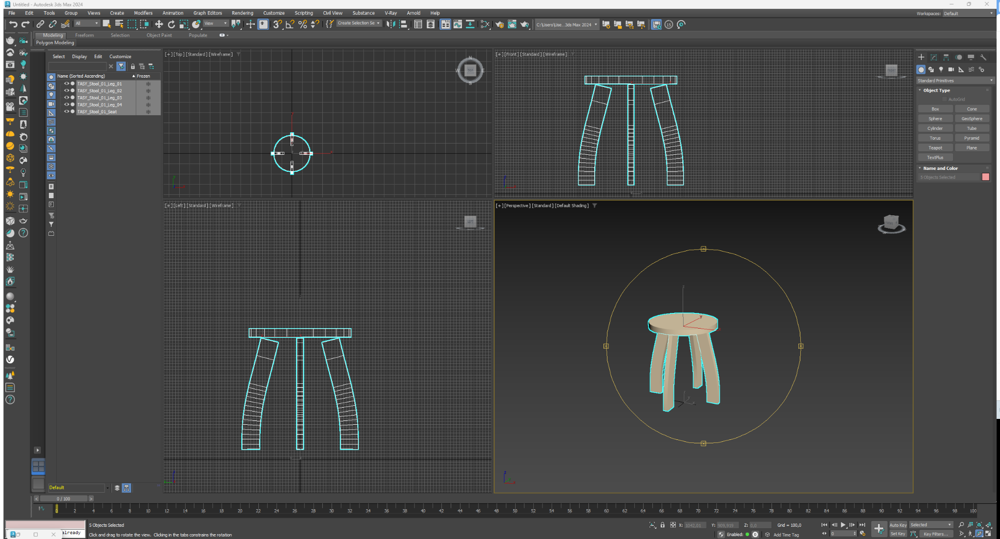
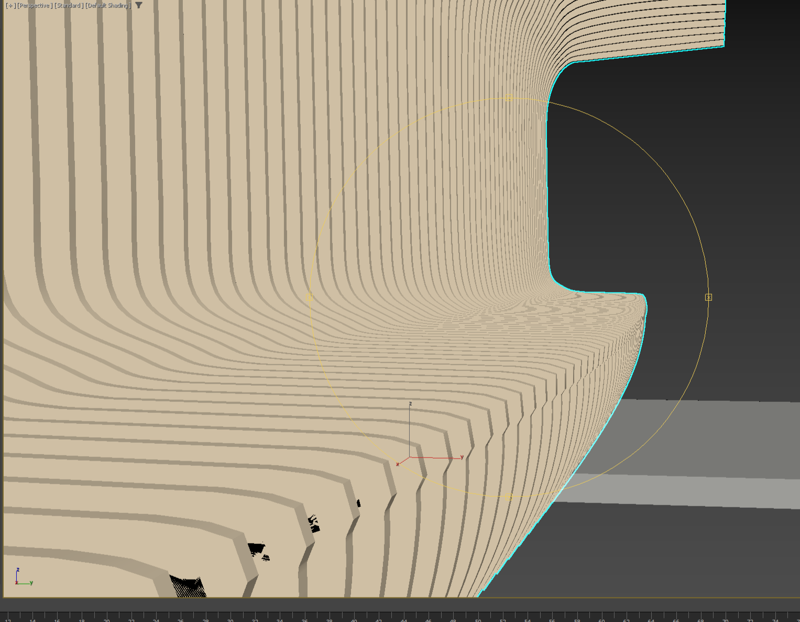
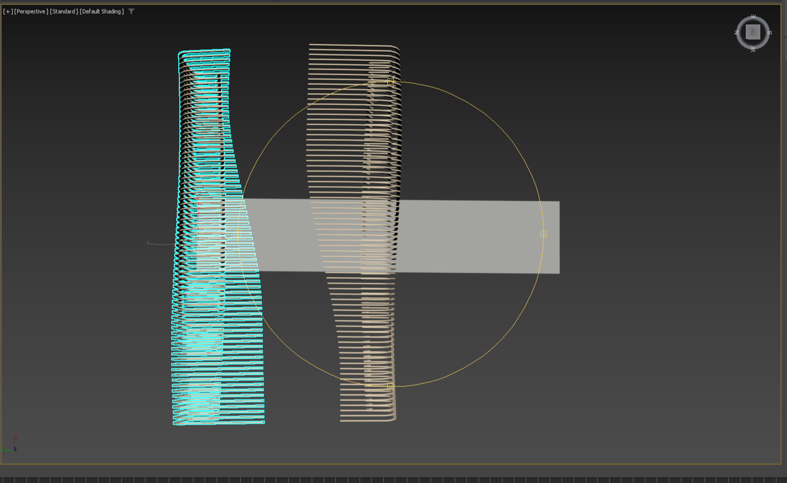
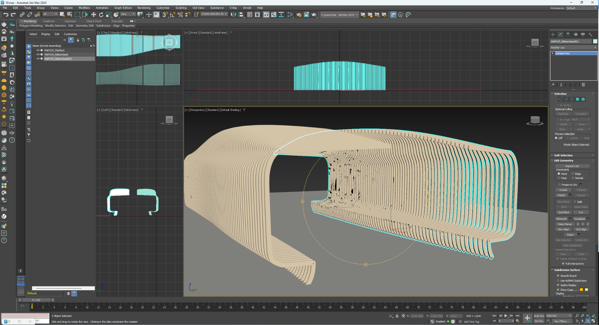

# Direct LLM Modeling in Autodesk 3ds Max

**A working experiment in direct modeling inside Autodesk 3ds Max 2024 using general-purpose ChatGPT.**

[Full research in English](RESEARCH_EN.md) · [Исследование на русском](RESEARCH_RU.md) · [Русская версия](README_RU.md)

## Download

**[⬇ DOWNLOAD ALL — TASY MaxBridge 0.6.1 PORTABLE](https://github.com/tvolkf-star/LLM-3D-Scene-Bridge/releases/download/v0.6.1-portable/TASY_MaxBridge_v0.6.1_PORTABLE_COMPLETE.zip)**

Portable bridge, examples, documentation, and images. [Release details](https://github.com/tvolkf-star/LLM-3D-Scene-Bridge/releases/tag/v0.6.1-portable).

## Bridge development

The approximately 8 KB Python/pymxs bridge was **developed as part of this research**, not obtained as an existing integration. Its architecture was designed in dialogue with ChatGPT, then implemented, tested and corrected against a running Autodesk 3ds Max 2024 installation.

The bridge provides the command-and-feedback channel: it accepts operations, executes them through the native 3ds Max Python/pymxs interface, and reports execution results, scene state and viewport captures. Modeling logic is not embedded in the bridge. The portable 0.6.1 build is a later working iteration of this experimental code.

The distinction matters: the experiment covers **both the construction of a minimal connection to professional software and the modeling work subsequently performed through that connection**.

## Architecture

No autonomous agent framework, specialized 3D model, text-to-3D generator, or custom modeling environment. Google Drive is a third-party synchronized transport layer. A compact Python/pymxs bridge executes operations inside a locally running Autodesk 3ds Max and returns observable results.

```text
Task → ChatGPT → Google Drive → local sync
                                  ↓
                          Python/pymxs bridge
                                  ↓
                           3ds Max 2024
                                  ↓
                       native editable geometry
                                  ↓
                     result + scene + viewport
                                  ↓
                         Google Drive → ChatGPT
                                       ↺
```

**Modeling decisions remain with the general-purpose LLM. Geometry remains native and editable inside 3ds Max.** No manual code copy-paste is required during the connected modeling loop.

## Experimental results

### 01. Control object: stool

Native construction, professional corrections, and independent reconstruction using an executable Python/pymxs scene script.



*Editable geometry in 3ds Max.* [Source scripts](examples/stools/).

### 02. Professional modeling-method transfer: pergola / urban furniture

The architect provided a reusable geometric method based on a changing profile and sampled states. ChatGPT applied that method to a new spatial construction. The test concerns transfer of a **modeling method**, not copying object coordinates.



*Single module.*



*Paired modules in 3ds Max.*



*Spatial composition.*

[Original command and Python source](examples/pergola/) · [Modeling method](docs/MODELING_METHOD.md).

### 03. New scene: MARGARITA

The scene was created in Autodesk 3ds Max through the portable bridge. The images distinguish the **actual editable viewport geometry** from a **generative architectural visualization based on that scene**. The latter is not a native 3ds Max render.


*Autodesk 3ds Max 2024 viewport: native editable geometry.*


*Generative architectural visualization based on the 3ds Max scene; not a native Max render.*

[MARGARITA reconstruction scripts](examples/margarita/).

### 04. Executable scene representation

A self-contained Python/pymxs program reconstructed an editable object in a separate clean instance of 3ds Max, without the source scene or bridge. See the [full research](RESEARCH_EN.md) for the experiment and its limitations.

## Installation

1. [Download the complete ZIP](https://github.com/tvolkf-star/LLM-3D-Scene-Bridge/releases/download/v0.6.1-portable/TASY_MaxBridge_v0.6.1_PORTABLE_COMPLETE.zip) and extract it to a writable local folder.
2. Open **Autodesk 3ds Max 2024 → Scripting → Run Script** and run `TASY_MaxBridge_061_PORTABLE.py`.
3. Synchronize the working folder using Google Drive for desktop and verify two-way file synchronization.
4. Give ChatGPT access to the corresponding Google Drive folder and project documentation.
5. Send a `ping` command with a unique `id`; check the matching `result.json` before modeling.

[Detailed installation guide (Russian)](docs/INSTALL_RU.md) · [File protocol](protocol/FILES.md).

**Security:** `execute_python` executes arbitrary Python with the privileges of the 3ds Max process. Use only trusted command sources and save existing scenes before experiments.

## Research and source files

[English research](RESEARCH_EN.md) · [Russian research](RESEARCH_RU.md) · [Portable bridge](TASY_MaxBridge_061_PORTABLE.py) · [Examples](examples/) · [Documentation](docs/).

This research does not claim to be the first LLM-to-3ds-Max integration. It documents the tested combination of a general-purpose LLM, minimal bridge, synchronized transport, closed feedback loop, native geometry, professional method transfer, and executable scene representation.

**Author:** Tasy Volkova · [Apache 2.0](LICENSE) · [tasy.pro](https://tasy.pro/)
